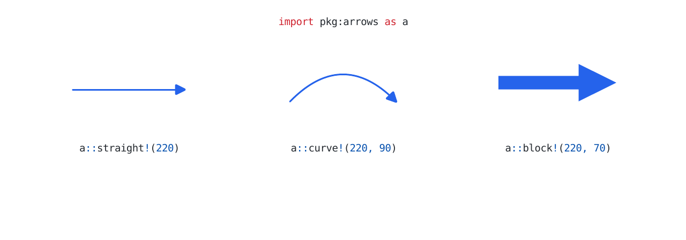
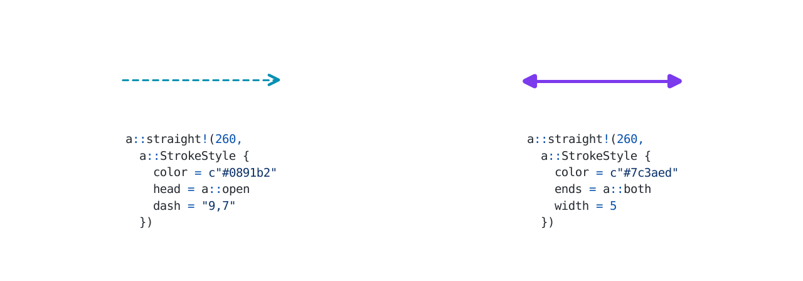
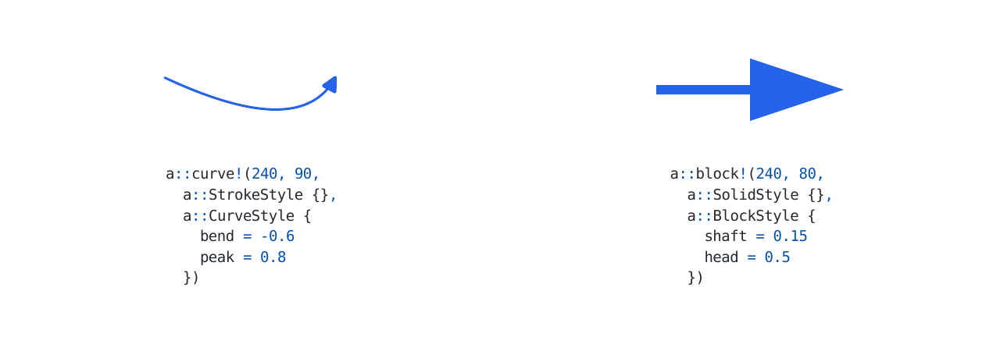

# arrows.ss

16 customizable vector arrows for ss.

## Install

Run in your ss project directory:

```sh
ss add --git https://github.com/abap34/arrows.git
```

## Usage

```ss
import pkg:arrows as a

page example
  a::straight!(220)
  a::curve!(220, 90)
  a::block!(220, 70)
end
```



## Customize

Use `StrokeStyle` for line arrows and `SolidStyle` for filled arrows.



Pass a shape-specific style as the fourth argument to adjust the geometry.



